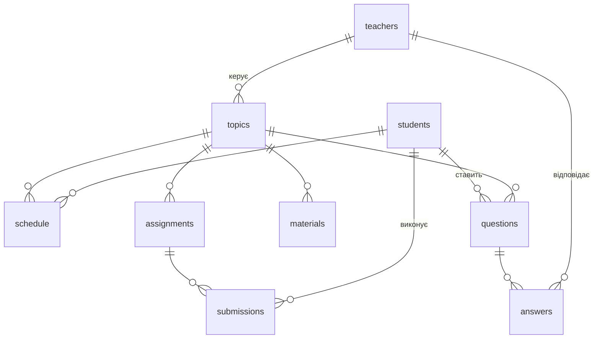

# Лабораторна робота №1

**Варіант 6.** Інформаційна система «Індивідуальна робота кафедри зі студентами».

## Завдання

Створити програму на Haskell з використанням класів типів (`class`) та їх
екземплярів (`instance`). Як базу даних використати MySQL.

Таблиці БД містять інформацію про студентів і викладачів, теми та графік
роботи, виконання завдань, допоміжні інформаційні матеріали до тем, питання
студентів і відповіді викладачів. Передбачити можливість введення та
коригування інформації. Кількість таблиць має бути більшою за 5.

## Що реалізовано

- База даних MySQL з **9 таблицями**, зовнішніми ключами, обмеженнями
  унікальності та `CHECK`.
- Консольний застосунок на Haskell, у якому для кожної таблиці є:
  перегляд усіх записів, пошук, перегляд за ID, **додавання, редагування,
  видалення**.
- Перевірка введених даних: формат дат, часу, чисел; бізнес-правила
  (наприклад, оцінка тільки для перевіреного завдання, оцінка 0–100,
  коректний email).
- 9 звітів із з'єднанням таблиць (`JOIN`) та пошук по всій базі.
- Повна підтримка українського тексту (UTF-8 / `utf8mb4`).

## Структура бази даних

| Таблиця       | Призначення                                   | Зв'язки                          |
|---------------|-----------------------------------------------|----------------------------------|
| `students`    | студенти: ПІБ, група, email, телефон          | —                                |
| `teachers`    | викладачі: ПІБ, посада, email, телефон        | —                                |
| `topics`      | теми індивідуальної роботи                    | `teacher_id → teachers`          |
| `schedule`    | графік роботи: зустрічі студента за темою     | `topic_id → topics`, `student_id → students` |
| `assignments` | завдання за темою з кінцевим терміном         | `topic_id → topics`              |
| `submissions` | виконання завдань: статус, дата здачі, оцінка | `assignment_id → assignments`, `student_id → students` |
| `materials`   | допоміжні інформаційні матеріали до тем       | `topic_id → topics`              |
| `questions`   | питання студентів                             | `student_id → students`, `topic_id → topics` |
| `answers`     | відповіді викладачів на питання               | `question_id → questions`, `teacher_id → teachers` |



Обмеження, які перевіряє сама СУБД:

- у студента не може бути двох зустрічей, що починаються одночасно
  (`UNIQUE (student_id, meeting_date, start_time)`); тривалість зустрічі —
  від 5 до 240 хвилин, і вона має закінчитися до півночі (`CHECK`);
- одне завдання видається студенту лише один раз
  (`UNIQUE (assignment_id, student_id)`);
- статус виконання — тільки `assigned`, `submitted` або `reviewed`,
  оцінка — від 0 до 100; статус узгоджений з датою здачі та оцінкою:
  `assigned` — без дати й оцінки, `submitted` — лише з датою,
  `reviewed` — з датою та оцінкою (`CHECK`).

Політика видалення:

- викладача **не можна видалити**, поки на нього посилаються теми або
  відповіді (`ON DELETE RESTRICT`). Так оцінки студентів і відповіді не
  зникають випадково: спершу теми треба передати іншому викладачу або
  видалити;
- решта залежних записів видаляється разом із батьківським
  (`ON DELETE CASCADE`). Наприклад, з темою видаляються її завдання,
  матеріали, зустрічі й питання. Перед підтвердженням програма показує,
  скільки записів у яких таблицях буде видалено. Ці дані вона бере зі
  схеми БД (`information_schema`).

Перетин зустрічей у часі (той самий студент, та сама аудиторія або той
самий керівник теми) перевіряє застосунок перед збереженням: MySQL не
може виразити таке правило ключем.

Схема — у файлі [`sql/schema.sql`](sql/schema.sql), тестові дані —
у [`sql/seed.sql`](sql/seed.sql).

## Класи типів та екземпляри

Основна ідея: операції з БД, форми та виведення таблиць написано **один раз**
у вигляді функцій над класами типів. Кожна таблиця описується лише
екземплярами класів.

| Клас (модуль)                     | Методи                                                    | Призначення |
|-----------------------------------|-----------------------------------------------------------|-------------|
| `Entity` (`Lab1.Entity`)          | `tableName`, `columns`, `searchColumns`, `orderColumn`, `entityId`, `toParams`, `summary` | опис таблиці; на ньому побудовано узагальнені `findAll`, `findById`, `insertEntity`, `updateEntity`, `deleteEntity`, `searchEntity` |
| `Tabular` (`Lab1.Entity`)         | `headers`, `cells`                                        | виведення записів у вигляді таблиці |
| `Form` (`Lab1.Form`)              | `form`, `validate`, `validateWith` (методи за замовчуванням) | інтерактивне введення/редагування; перевірка правил без БД (`validate`) і з БД (`validateWith`, напр. перетин зустрічей) |
| `Input` (`Lab1.Console`)          | `parseInput`, `showInput`, `inputHint`                    | читання значень з консолі: `Text`, `Int`, `Day`, `TimeOfDay`, `SubmissionStatus` |
| `QueryResults` (mysql-simple)     | `convertResults`                                          | перетворення рядка результату запиту в запис Haskell (строге, щоб помилки виникали всередині запиту) |
| `Param`, `Result` (mysql-simple)  | `render`, `convert`                                       | зберігання власного типу `SubmissionStatus` у стовпці `VARCHAR` |

Типи предметної області (`Lab1.Model`): `Student`, `Teacher`, `Topic`,
`ScheduleEntry`, `Assignment`, `Submission`, `Material`, `Question`, `Answer`
та перелічуваний тип `SubmissionStatus = Assigned | Submitted | Reviewed`.

Приклад екземпляра для таблиці студентів:

```haskell
instance Entity Student where
  tableName = "students"
  entityName = "student"
  columns = ["full_name", "group_name", "email", "phone"]
  orderColumn = "full_name"
  entityId = studentId
  toParams s = [render (studentName s), render (studentGroup s), ...]
  summary s = studentName s <> " (" <> studentGroup s <> ")"

instance Form Student where
  form _ old =
    Student (maybe 0 studentId old)
      <$> askField "Full name" (studentName <$> old)
      <*> askField "Group" (studentGroup <$> old)
      <*> askOptional "Email" (studentEmail <$> old)
      <*> askOptional "Phone" (studentPhone <$> old)
  validate s = emailRule (studentEmail s)
```

Узагальнена функція працює для будь-якої таблиці. Потрібний тип обирається
через `TypeApplications`:

```haskell
findAll @Student conn      -- SELECT ... FROM students ORDER BY full_name
entityMenu @Question conn "Student questions"   -- те саме меню для будь-якого типу
```

## Структура проєкту

```
лаб1/
├── app/Main.hs            -- точка входу: підключення до БД, головне меню
├── src/Lab1/
│   ├── Config.hs          -- параметри підключення (змінні середовища)
│   ├── Console.hs         -- клас Input, введення значень з консолі
│   ├── Entity.hs          -- класи Entity і Tabular, узагальнені CRUD та пошук
│   ├── Form.hs            -- клас Form, вибір пов'язаного запису за ID
│   ├── Model.hs           -- типи даних та їх екземпляри
│   ├── Reports.hs         -- звіти з JOIN та пошук по всій БД
│   └── Menu.hs            -- меню, обробка помилок
├── sql/schema.sql         -- створення БД і таблиць
├── sql/seed.sql           -- тестові дані
├── Звіт_ЛР1_варіант6.docx -- звіт з лабораторної роботи
├── lab1.cabal
├── cabal.project          -- налаштування збирання залежностей
└── cabal.project.local    -- шляхи до бібліотек саме цієї машини (Homebrew)
```

## Встановлення та запуск (macOS, Homebrew)

1. Встановити інструменти:

   ```bash
   brew install ghc cabal-install mysql pkg-config pcre
   ```

2. Запустити MySQL:

   ```bash
   mysql.server start
   ```

3. Створити БД і заповнити її тестовими даними (виконувати в папці `лаб1`;
   команда **видаляє** наявну БД `dept_individual_work`):

   ```bash
   mysql -uroot < sql/schema.sql && mysql -uroot dept_individual_work < sql/seed.sql
   ```

4. Зібрати та запустити застосунок:

   ```bash
   cabal run lab1
   ```

Параметри підключення за замовчуванням: користувач `root` без пароля,
сервер `127.0.0.1:3306` (TCP), база `dept_individual_work`. Їх можна
змінити через змінні середовища `LAB1_DB_HOST`, `LAB1_DB_PORT`,
`LAB1_DB_USER`, `LAB1_DB_PASSWORD`, `LAB1_DB_NAME`:

```bash
LAB1_DB_PORT=3307 LAB1_DB_USER=student LAB1_DB_PASSWORD=secret cabal run lab1
```

Хост за замовчуванням — саме IP-адреса. Для імені `localhost` клієнт MySQL
підключається через Unix-сокет і ігнорує порт. Некоректне значення
`LAB1_DB_PORT` програма не замінює мовчки: вона повідомляє про помилку.

> Щоб консольний клієнт `mysql` правильно показував кирилицю, додайте
> параметр `--default-character-set=utf8mb4`.
>
> Програма очікує введення в UTF-8. У консолі Windows спершу виконайте
> `chcp 65001`. Рядок, який не вдалося декодувати, програма відхиляє та
> просить ввести ще раз.

### Особливості збирання

Пакети `pcre-light` і `mysql`, від яких залежить `mysql-simple`, мають власні
скрипти `Setup.hs`, що несумісні з Cabal 3.14+. Тому в `cabal.project` ці
скрипти збираються старішою версією Cabal (`setup.Cabal < 3.14`).

Клієнт MySQL потребує бібліотек zstd та OpenSSL, але `mysql_config` не
повідомляє шляхів до них. Ці шляхи залежать від машини, тому їх винесено у
`cabal.project.local`:

- macOS на Apple Silicon (Homebrew у `/opt/homebrew`) — файл уже
  налаштований;
- macOS на Intel — замініть у файлі `/opt/homebrew` на `/usr/local`;
- Linux з пакетом `libmysqlclient-dev` — файл можна видалити.

Перевірено з GHC 9.14.1, cabal 3.18 і MySQL 26.10.

## Робота з програмою

Головне меню:

```
=== Individual work of the department with students ===
 1. Students
 2. Teachers
 3. Topics
 4. Work schedule
 5. Assignments
 6. Assignment completion
 7. Information materials
 8. Student questions
 9. Teacher answers
10. Reports and search
 0. Exit
```

Для кожної таблиці (пункти 1–9) однакове підменю: `Show all`, `Search`,
`Show by ID`, `Add`, `Edit`, `Delete`.

- Введення `!` у будь-якому полі скасовує поточну дію (форму, звіт,
  видалення) і повертає до меню.
- Під час **редагування** в дужках показано поточне значення. Порожнє
  введення (Enter) його зберігає, `-` очищає необов'язкове поле.
- Під час введення зовнішнього ключа (наприклад, викладача для теми)
  програма спершу показує список доступних записів. Якщо записів більше 15,
  вона спершу просить фільтр (частину ПІБ, назви тощо).
- Числа мають уміщатися в діапазон стовпця `INT`. Занадто велике число
  відхиляється, а не «перевертається» в інше значення.
- Якщо запис не пройшов перевірку або його відхилила СУБД (наприклад,
  повторний email, зайнятий час у розкладі, задовге значення), програма
  показує причину і пропонує виправити значення. Уже введені дані при цьому
  зберігаються як значення за замовчуванням.

Звіти (пункт 10):

| Звіт | Що показує |
|------|------------|
| Search in the whole database | пошук тексту одночасно в студентах, викладачах, темах, завданнях, матеріалах, питаннях і відповідях |
| Progress of a student | усі завдання студента зі статусом, датою здачі, оцінкою, кількістю перевірених і середнім балом |
| Overdue assignments | завдання, не здані після кінцевого терміну, і кількість днів прострочення |
| Unanswered questions | питання без відповіді та відповідальний викладач |
| Topic overview | картка теми: керівник, матеріали, завдання з кількістю виконаних і середньою оцінкою |
| Questions and answers on a topic | питання за темою разом із відповідями викладачів |
| Schedule for a period | графік зустрічей за період з часом початку й кінця (за замовчуванням — два тижні; кінець періоду не може бути раніше початку) |
| Teacher workload | кількість тем, зустрічей, наданих відповідей і відкритих питань у кожного викладача |
| Student rating | студенти за спаданням середньої оцінки |

Приклад звіту:

```
--- Overdue assignments on 2026-10-21 ---
Student                      | Group | Assignment            | Topic                 | Deadline   | Days late
-----------------------------+-------+-----------------------+-----------------------+------------+----------
Коваленко Максим Ігорович    | КН-31 | Паралельне сортування | Паралельні обчислення | 2026-10-15 | 6
Мельник Дмитро Олександрович | ПМ-21 | Комбінатори SKI       | Лямбда-числення       | 2026-10-18 | 3
2 record(s)
```

## Висновки

У роботі створено інформаційну систему на Haskell з базою даних MySQL.
Класи типів дозволили відокремити загальну логіку від конкретних таблиць:
узагальнені CRUD-операції, пошук, меню, форми й табличне виведення написані
один раз. Кожна з 9 таблиць підключається лише набором екземплярів `Entity`,
`Tabular` і `Form`. Класи бібліотеки `mysql-simple` (`QueryResults`, `Param`,
`Result`) використано, щоб перетворювати рядки БД у типи Haskell, зокрема
власний тип `SubmissionStatus`. Методи за замовчуванням (`validate`,
`searchColumns`, `orderColumn`, `inputHint`) скорочують код екземплярів.
