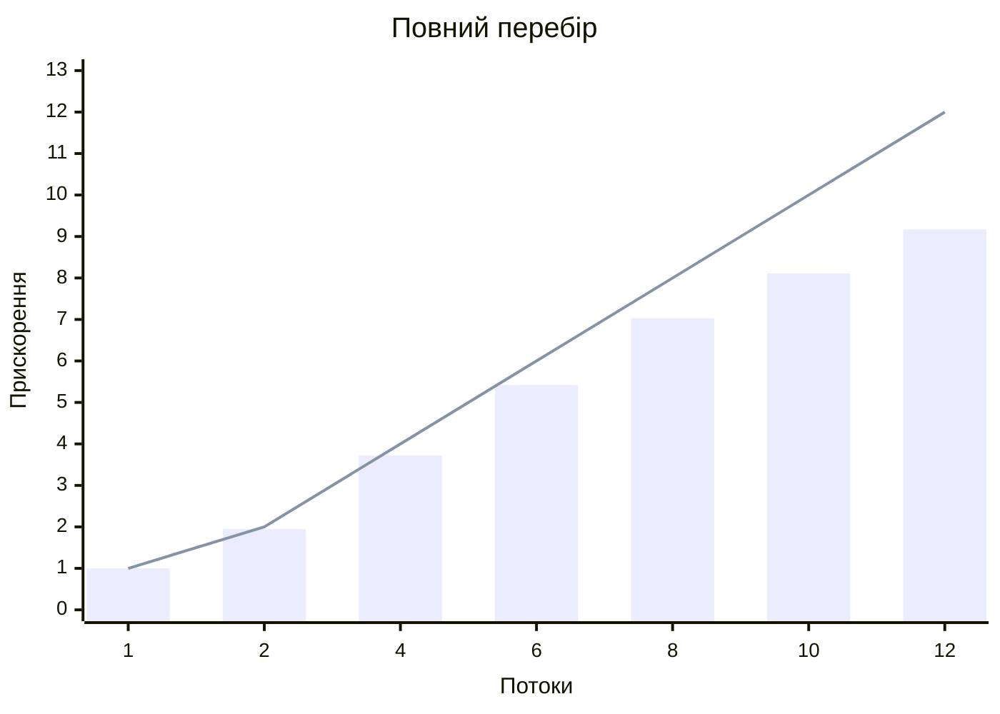
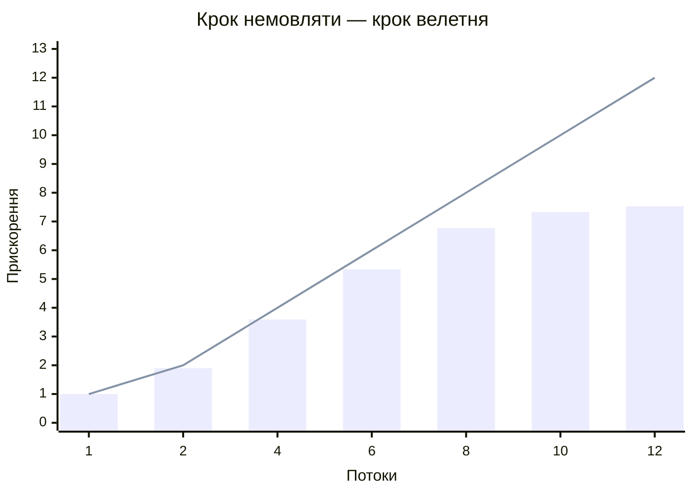
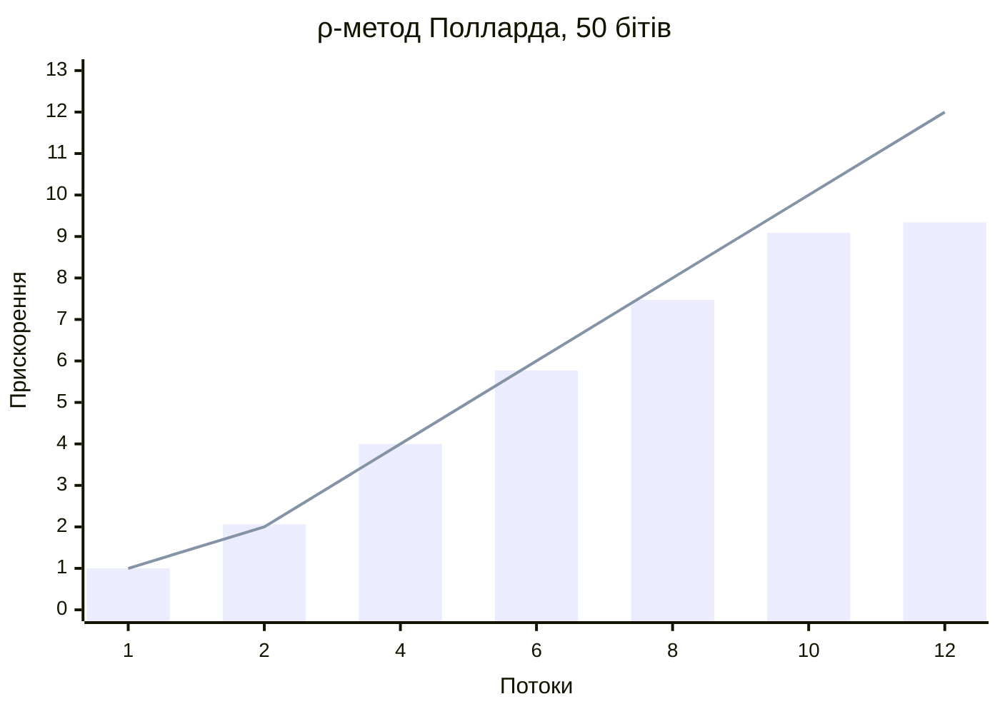
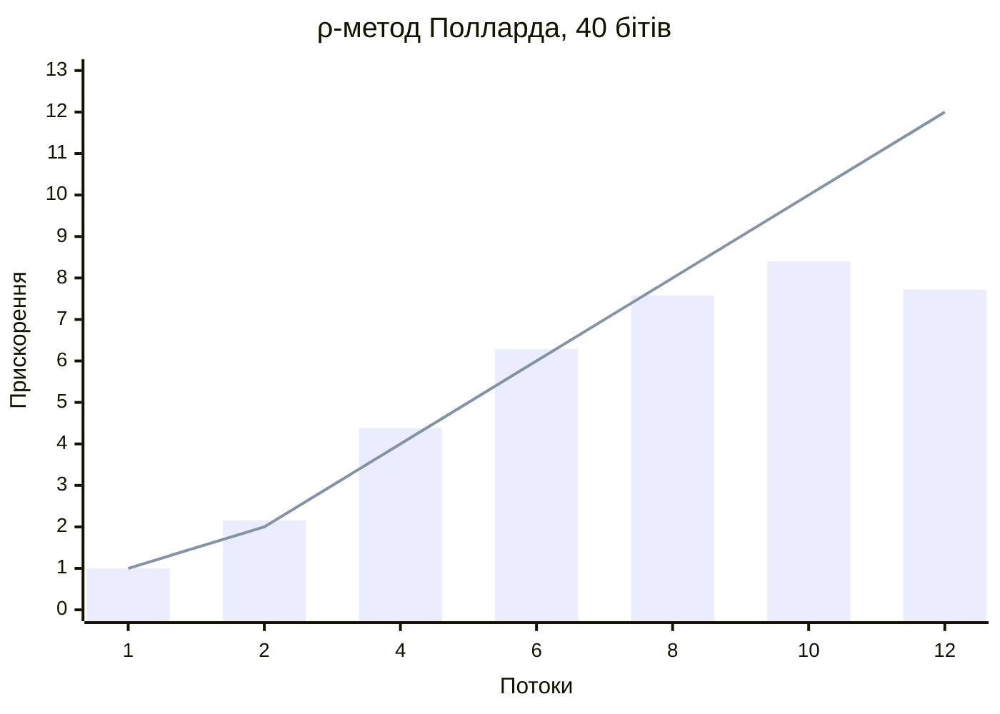

# Лабораторна робота №2

**Варіант 5.** Розв'язання задачі дискретного логарифмування паралельними
алгоритмами.

## Завдання

Використовуючи Haskell (GHC з ключем `-threaded`), створити багатопотоковий
додаток: використовуючи паралельні алгоритми, вирішити задачу дискретного
логарифмування.

## Мета роботи

Ознайомитися із засобами паралельного та конкурентного програмування в
Haskell (потоки `forkIO`/`forkOn`, багатопотокове середовище виконання GHC,
`MVar`, атомарні операції над `IORef`), реалізувати послідовні й паралельні
версії алгоритмів дискретного логарифмування та виміряти прискорення на
багатоядерному процесорі.

## Постановка задачі

Дано просте число `p`, основа `g` і значення `h` (`1 ≤ g, h < p`). Потрібно
знайти показник `x`, для якого

```
g^x ≡ h (mod p).
```

Нехай `n` — порядок `g`, тобто найменше `n > 0` з `g^n ≡ 1 (mod p)`. Тоді всі
розв'язки мають вигляд `x + k·n`, і програма шукає єдиний розв'язок з
проміжку `[0, n)`. Мультиплікативна група за простим модулем циклічна, тому
розв'язок існує тоді й лише тоді, коли `h^n ≡ 1 (mod p)`.

Для обчислення `n` програма розкладає `p − 1` на прості множники
(пробне ділення та ρ-метод Полларда для факторизації) і перевіряє дільники.
Простоту чисел перевіряє детермінований тест Міллера — Рабіна. Випадкові
задачі будуються з безпечних простих чисел `p = 2q + 1` (`q` теж просте):
тоді порядок групи `p − 1 = 2q` має великий простий дільник, і задача
справді складна.

Усі обчислення ведуться в 64-бітних машинних словах, модуль `p < 2^62`.
Добуток двох лишків до 2^62 не вміщується в 64 біти, тому множення за модулем
використовує 128-бітні примітиви GHC (`timesWord2#`, `quotRemWord2#`), а для
`p < 2^32` — звичайне ділення.

## Алгоритми

| Алгоритм | Час | Пам'ять | Розпаралелювання |
|----------|-----|---------|------------------|
| Повний перебір | `O(n)` | `O(1)` | блоки показників розподіляються між потоками по колу |
| «Крок немовляти — крок велетня» (BSGS, Шенкс) | `O(√n)` | `O(√n)` | паралельна побудова таблиці (блочне сортування) і паралельні великі кроки |
| ρ-метод Полларда | `O(√n)` в середньому | `O(1)` | незалежні блукання з відмітними точками (ван Ооршот — Вінер) |

Кожен алгоритм має послідовну та паралельну версії.

### Повний перебір

Обчислюються `g^0, g^1, g^2, …` (кожен наступний член — множенням на `g`),
доки не з'явиться `h`. Показники розбито на блоки по 65 536 штук; потік `w`
з `k` обробляє блоки `w, w + k, w + 2k, …`. Перший елемент наступного блоку
потік отримує одним множенням на `g^(k·65536)`. Отже, усі потоки рухаються
по проміжку разом, і розв'язок з будь-якою позицією `x` знаходиться приблизно
за `x / k` кроків кожного потоку. При рівномірному розбитті на `k` суцільних
частин так не було б: якби `x` лежав на початку частини, знайдений був би
відразу, а якби в кінці — лише після повного проходу частини.

### «Крок немовляти — крок велетня»

Нехай `m = ⌈√n⌉`. Будь-яке `x < n` записується як `x = i·m + j`, де
`0 ≤ i, j < m`, і рівняння перетворюється на

```
g^j ≡ h · (g^(−m))^i (mod p).
```

Спершу будується таблиця «кроків немовляти» `(g^j, j)` для `j < m`,
відсортована за значенням. Потім обчислюються «кроки велетня»
`h · (g^(−m))^i`, і кожен шукається в таблиці двійковим пошуком. Збіг з
`g^j` дає `x = i·m + j`.

Паралельна версія:

1. **Побудова таблиці без злиття (блочне сортування).** Лишки рівномірно
   розподілені на `[1, p)`, тому діапазон ключів ділиться на `k` рівних
   «кошиків».
   1. Кожен потік обчислює свою частину кроків і рахує, скільки значень
      потрапляє в кожен кошик.
   2. Префіксні суми лічильників дають кожному потоку власне місце в кожному
      кошику.
   3. Кожен потік копіює свої значення на ці місця. Записи різних потоків не
      перетинаються, тому синхронізація не потрібна.
   4. Кожен потік сортує один кошик. Усі ключі кошика `b` менші за ключі
      кошика `b + 1`, тож після цього відсортований увесь масив.
2. **Великі кроки** розподіляються між потоками тим самим блочним способом,
   що й повний перебір.

### ρ-метод Полларда

Метод розглядає псевдовипадкове блукання по елементах `y = g^a · h^b` і
запам'ятовує показники `a` та `b`. Якщо два блукання (або одне блукання саме
з собою) зустрілися, `g^a h^b = g^a' h^b'`, звідки

```
x · (b' − b) ≡ a − a' (mod n).
```

Це лінійне порівняння має `d = gcd(b' − b, n)` розв'язків. Програма
перевіряє їх і обирає справжній. За парадоксом днів народження збіг
очікується приблизно через `√(π n / 2)` кроків.

- **Послідовна версія** — класичний метод Полларда: група ділиться на три
  класи за `y mod 3` (множення на `h`, піднесення до квадрата, множення на
  `g`), а цикл шукає метод Флойда. «Черепаха» робить один крок, «заєць» —
  два, доки вони не зустрінуться.
- **Паралельна версія** — метод відмітних точок ван Ооршота — Вінера. Усі
  потоки використовують одну функцію блукання: додавальне блукання Теске з
  32 заздалегідь обчисленими множниками `g^(c_s) · h^(d_s)`. Кожен потік
  починає блукання з власних випадкових точок. Точка «відмітна», якщо її
  молодші `t` бітів нульові, тобто приблизно одна точка з `2^t`. Потоки
  повідомляють у спільну таблицю лише відмітні точки. Блукання, що
  зустрілися, далі йдуть однаково й доходять до однієї відмітної точки, де
  збіг і помічається. Після кожної відмітної точки потік починає нове
  блукання, попередньо перевіривши прапорець зупинки. Без цієї перевірки
  на малих задачах, де блукання коротші за інтервал перевірки всередині
  блукання, інші потоки не помічали б, що відповідь уже знайдено. Робота
  ділиться між потоками, і очікуваний час спадає майже лінійно. Метод Флойда так не
  розпаралелюється: `k` незалежних блукань з пошуком циклу дають прискорення
  лише близько `√k`.

  Параметр `t` вибирається як `⌊log₂ n⌋ / 2 − 8`, щоб до збігу з'явилося
  близько 2^8 відмітних точок: таблиця залишається маленькою, а збіг
  помічається невдовзі після того, як він стався.

## Багатопотоковість у програмі

- Виконуваний файл збирається з `-threaded -rtsopts "-with-rtsopts=-N"`:
  середовище виконання GHC створює стільки «можливостей» (capabilities),
  скільки ядер має процесор. Кількість можна змінити, наприклад
  `+RTS -N4`.
- Робочі потоки запускаються через `forkOn i` (потік `i` закріплюється за
  можливістю `i`). Головний потік чекає завершення всіх робочих через
  `MVar`. Виняток у робочому потоці передається в головний (модуль
  `Lab2.Parallel`, функція `runWorkers`). Якщо ж перервано сам головний
  потік (наприклад, обмеженням часу `timeout`), робочі потоки завершуються
  через `killThread`, а не залишаються працювати. Запуск виконується в
  `mask`, щоб жоден потік не загубився між створенням і записом.
- Кількість потоків — від 1 до 1024 (`workerCount`). Обмеження діє і в
  командному рядку, і в самій бібліотеці: службові масиви BSGS ростуть
  пропорційно квадрату кількості потоків, а 0 потоків не повинні означати
  «розв'язку немає».
- Схема «перший знайшов — решта зупиняються» (`parallelSearch`): перший
  знайдений результат записується атомарно (`atomicModifyIORef'`), після
  чого встановлюється спільний прапорець зупинки (`atomicWriteIORef`).
  Потоки перевіряють прапорець раз на блок (65 536 кроків), а в ρ-методі —
  перед кожним блуканням і раз на 65 536 кроків довгого блукання, тому
  майже не конкурують за пам'ять.
- Спільна таблиця відмітних точок ρ-методу — незмінна `Data.Map` в `IORef`,
  яка оновлюється атомарно через `atomicModifyIORef'`. Звернення до неї
  рідкісні (раз на `2^t` кроків), тож блокування не потрібні.
- Обчислення всередині потоків — чисті функції. Змінювані масиви (таблиця
  BSGS) потоки заповнюють лише в частинах, що не перетинаються, тому гонок
  даних немає.

Внутрішні цикли пишуться так, щоб GHC компілював їх у роботу з машинними
словами без виділення пам'яті: строгі аргументи (`BangPatterns`),
розпаковані строгі поля (`Hit {-# UNPACK #-} !Word …`), окрема функція
верхнього рівня для перегляду блоку. Спосіб множення (звичайне ділення
для `p < 2^32` або 128-бітне) вибирається один раз перед циклом, а не на
кожному кроці.

## Структура проєкту

```
лаб2/
├── app/Main.hs              -- командний рядок: solve, generate, bench
├── src/Lab2/
│   ├── Arith.hs             -- модульна арифметика на 64-бітних словах
│   ├── Prime.hs             -- Міллер — Рабін, факторизація, порядок, первісний корінь
│   ├── Problem.hs           -- задача, перевірка, генерація, розв'язання збігу
│   ├── Parallel.hs          -- робочі потоки, паралельний пошук, блочний перегляд
│   ├── BruteForce.hs        -- повний перебір
│   ├── BabyGiant.hs         -- «крок немовляти — крок велетня»
│   ├── PollardRho.hs        -- ρ-метод Полларда (Флойд і відмітні точки)
│   ├── Solver.hs            -- спільний інтерфейс алгоритмів
│   ├── Bench.hs             -- вимірювання часу та прискорення
│   └── Table.hs             -- виведення таблиць у форматі Markdown
├── test/Spec.hs             -- властивості QuickCheck
├── results/                 -- результати вимірювань
└── lab2.cabal
```

## Збирання та запуск

Потрібні GHC і cabal (перевірено з GHC 9.14.1 і cabal 3.18):

```bash
cabal build
```

Розв'язати випадкову задачу з 40-бітним `p` усіма алгоритмами
(послідовно та паралельно):

```bash
cabal run lab2 -- solve --bits 40
```

Розв'язати задану задачу (`-y` — значення `h`) лише ρ-методом на 4 потоках:

```bash
cabal run lab2 -- solve -p 1000000007 -g 5 -y 123456789 -a rho -t 4
```

Програма друкує використане зерно (`Seed`) випадкової задачі та
випадкових блукань ρ-методу. Щоб повторити запуск точно, його можна задати
опцією `--seed`.

Згенерувати задачу з відомою відповіддю:

```bash
cabal run lab2 -- generate --bits 48 --seed 1
```

Виміряти прискорення:

```bash
cabal run lab2 -- bench -a rho -b 50 -t 1,2,4,8,12 -r 30
```

Запустити тести:

```bash
cabal test
```

Обмеження розміру:

- повний перебір — порядок `n ≤ 2^34`. Для `p > 2^32` кожен крок потребує
  128-бітного множення (≈ 12 нс), тож один потік працює до ≈ 3,5 хв;
- BSGS — `n ≤ 2^46`: таблиця з 2^23 пар займає 128 МБ, а під час
  паралельної побудови потрібен ще один масив такого ж розміру (до 256 МБ);
- ρ-метод — будь-яке `p < 2^62`.

Задачі, що перевищують межу, програма пропускає з поясненням. Довідка:
`cabal run lab2 -- --help`.

## Приклади роботи

Випадкова 30-бітна задача, усі алгоритми (послідовні та паралельні на
12 потоках). Усі версії знаходять той самий показник, і програма перевіряє
відповідь:

```
$ lab2 solve -b 30 -s 7
Random problem
Seed: 7
p = 624841703, g = 5, h = 144791543
Order of g: n = 624841702 (about 2^29.2)
Worker threads: 12; runtime capabilities (+RTS -N): 12; CPU cores: 12

| Algorithm            | Version    | Threads | x         | Time, s |
|----------------------|------------|---------|-----------|---------|
| Brute force          | sequential | 1       | 504345213 | 1.693   |
| Brute force          | parallel   | 12      | 504345213 | 0.200   |
| Baby-step giant-step | sequential | 1       | 504345213 | 0.002   |
| Baby-step giant-step | parallel   | 12      | 504345213 | 0.002   |
| Pollard's rho        | sequential | 1       | 504345213 | 0.001   |
| Pollard's rho        | parallel   | 12      | 504345213 | 0.002   |

Check passed: 5^504345213 mod 624841703 = 144791543
```

На такій маленькій задачі алгоритми з `O(√n)` працюють мілісекунди, і
паралельність майже нічого не дає: запуск потоків коштує стільки ж, скільки
сама робота. Вона окупається на великих задачах.

44-бітна задача: повний перебір пропущено, бо він тривав би години:

```
$ lab2 solve -b 44 -s 11
Random problem
Seed: 11
p = 12279257097683, g = 2, h = 7008032553592
Order of g: n = 12279257097682 (about 2^43.5)
Worker threads: 12; runtime capabilities (+RTS -N): 12; CPU cores: 12

| Algorithm            | Version    | Threads | x                         | Time, s |
|----------------------|------------|---------|---------------------------|---------|
| Brute force          | -          | -       | skipped: order above 2^34 | -       |
| Baby-step giant-step | sequential | 1       | 7421042323227             | 0.579   |
| Baby-step giant-step | parallel   | 12      | 7421042323227             | 0.085   |
| Pollard's rho        | sequential | 1       | 7421042323227             | 0.370   |
| Pollard's rho        | parallel   | 12      | 7421042323227             | 0.005   |

Check passed: 2^7421042323227 mod 12279257097683 = 7008032553592
```

56-бітна задача, лише ρ-метод:

```
$ lab2 solve -b 56 -s 3 -a rho
Random problem
Seed: 3
p = 64883411856556859, g = 2, h = 11335154938492929
Order of g: n = 64883411856556858 (about 2^55.8)
Worker threads: 12; runtime capabilities (+RTS -N): 12; CPU cores: 12

| Algorithm     | Version    | Threads | x                 | Time, s |
|---------------|------------|---------|-------------------|---------|
| Pollard's rho | sequential | 1       | 26268092814296615 | 28.820  |
| Pollard's rho | parallel   | 12      | 26268092814296615 | 0.490   |

Check passed: 2^26268092814296615 mod 64883411856556859 = 11335154938492929
```

Задача без розв'язку: `g = 4` — квадратичний лишок за модулем `10^9 + 7`
(порядок `(p − 1) / 2`), а `h = 5` — ні, тож `h` не є степенем `g`:

```
$ lab2 solve -p 1000000007 -g 4 -y 5 -s 1
Seed: 1
p = 1000000007, g = 4, h = 5
Order of g: n = 500000003 (about 2^28.9)
Worker threads: 12; runtime capabilities (+RTS -N): 12; CPU cores: 12

| Algorithm            | Version    | Threads | x           | Time, s |
|----------------------|------------|---------|-------------|---------|
| Brute force          | sequential | 1       | no solution | 1.676   |
| Brute force          | parallel   | 12      | no solution | 0.187   |
| Baby-step giant-step | sequential | 1       | no solution | 0.002   |
| Baby-step giant-step | parallel   | 12      | no solution | 0.002   |
| Pollard's rho        | sequential | 1       | no solution | 0.000   |
| Pollard's rho        | parallel   | 12      | no solution | 0.000   |

No solution: h is not a power of g modulo p.
```

Генерація задачі з відомою відповіддю:

```
$ lab2 generate -b 48 -s 1
Random problem, seed 1
p = 247917550857443, g = 2, h = 244776264429272
Order of g: n = 247917550857442 (about 2^47.8)
Answer: x = 242008509036172
Solve it with: lab2 solve -p 247917550857443 -g 2 -y 244776264429272
```

Некоректні дані програма відхиляє з поясненням (код завершення 1):

```
$ lab2 solve -p 100 -g 2 -y 3
Error: p = 100 is not prime
$ lab2 solve -b 70
option -b: the size must be from 8 to 62 bits
$ lab2 solve -b 30 -t 2000
option -t: the number of threads must be from 1 to 1024
$ lab2 bench -a brute -b 50
Error: Brute force is limited to orders below 2^34, use fewer bits
```

## Вимірювання ефективності

Комп'ютер: Apple M4 Pro, 12 ядер (8 продуктивних і 4 енергоефективних),
macOS, GHC 9.14.1 з `-O2`. Для кожної конфігурації наведено середній і
найменший час кількох запусків на одній і тій самій випадковій задачі.
Перед кожним запуском виконується повне прибирання сміття
(`performMajorGC`), щоб воно не потрапляло в час наступного запуску.

- **Прискорення відносно 1 потоку** — `T(1) / T(k)` для паралельної версії.
- **Прискорення відносно послідовної версії** — `T_посл / T(k)`.
- **Ефективність** — прискорення відносно 1 потоку, поділене на `k`.

### Повний перебір, 32 біти

32-бітне `p` (порядок ≈ 2^31.3), 3 запуски:

| Version    | Threads | Mean, s | Min, s | Speedup vs 1 thread | Speedup vs sequential | Efficiency |
|------------|---------|---------|--------|---------------------|-----------------------|------------|
| sequential | 1       | 5.062   | 5.051  | -                   | 1.00                  | -          |
| parallel   | 1       | 5.051   | 5.045  | 1.00                | 1.00                  | 1.00       |
| parallel   | 2       | 2.585   | 2.584  | 1.95                | 1.96                  | 0.98       |
| parallel   | 4       | 1.358   | 1.353  | 3.72                | 3.73                  | 0.93       |
| parallel   | 6       | 0.931   | 0.929  | 5.42                | 5.44                  | 0.90       |
| parallel   | 8       | 0.718   | 0.716  | 7.03                | 7.05                  | 0.88       |
| parallel   | 10      | 0.623   | 0.614  | 8.11                | 8.12                  | 0.81       |
| parallel   | 12      | 0.551   | 0.542  | 9.17                | 9.19                  | 0.76       |



### «Крок немовляти — крок велетня», 46 бітів

46-бітне `p` (порядок ≈ 2^45.9, таблиця з 8,1 млн записів), 3 запуски:

| Version    | Threads | Mean, s | Min, s | Speedup vs 1 thread | Speedup vs sequential | Efficiency |
|------------|---------|---------|--------|---------------------|-----------------------|------------|
| sequential | 1       | 1.986   | 1.965  | -                   | 1.00                  | -          |
| parallel   | 1       | 2.024   | 2.016  | 1.00                | 0.98                  | 1.00       |
| parallel   | 2       | 1.066   | 1.054  | 1.90                | 1.86                  | 0.95       |
| parallel   | 4       | 0.564   | 0.552  | 3.59                | 3.52                  | 0.90       |
| parallel   | 6       | 0.379   | 0.378  | 5.34                | 5.24                  | 0.89       |
| parallel   | 8       | 0.299   | 0.298  | 6.77                | 6.65                  | 0.85       |
| parallel   | 10      | 0.276   | 0.265  | 7.33                | 7.20                  | 0.73       |
| parallel   | 12      | 0.269   | 0.256  | 7.53                | 7.39                  | 0.63       |



### ρ-метод Полларда, 50 бітів

50-бітне `p` (порядок ≈ 2^49.9), 60 запусків з різними випадковими
блуканнями:

| Version    | Threads | Mean, s | Min, s | Speedup vs 1 thread | Speedup vs sequential | Efficiency |
|------------|---------|---------|--------|---------------------|-----------------------|------------|
| sequential | 1       | 1.546   | 0.459  | -                   | 1.00                  | -          |
| parallel   | 1       | 0.786   | 0.132  | 1.00                | 1.97                  | 1.00       |
| parallel   | 2       | 0.382   | 0.029  | 2.06                | 4.05                  | 1.03       |
| parallel   | 4       | 0.197   | 0.030  | 4.00                | 7.86                  | 1.00       |
| parallel   | 6       | 0.136   | 0.030  | 5.77                | 11.34                 | 0.96       |
| parallel   | 8       | 0.105   | 0.031  | 7.47                | 14.68                 | 0.93       |
| parallel   | 10      | 0.086   | 0.011  | 9.09                | 17.87                 | 0.91       |
| parallel   | 12      | 0.084   | 0.009  | 9.34                | 18.37                 | 0.78       |



### ρ-метод Полларда, 40 бітів

40-бітне `p`, 60 запусків. Тут блукання короткі (у середньому 2^12 кроків
до відмітної точки), тож потоки повинні помічати прапорець зупинки перед
кожним новим блуканням:

| Version    | Threads | Mean, s | Min, s | Speedup vs 1 thread | Speedup vs sequential | Efficiency |
|------------|---------|---------|--------|---------------------|-----------------------|------------|
| sequential | 1       | 0.059   | 0.003  | -                   | 1.00                  | -          |
| parallel   | 1       | 0.030   | 0.004  | 1.00                | 1.96                  | 1.00       |
| parallel   | 2       | 0.014   | 0.003  | 2.16                | 4.23                  | 1.08       |
| parallel   | 4       | 0.007   | 0.002  | 4.38                | 8.58                  | 1.10       |
| parallel   | 6       | 0.005   | 0.002  | 6.29                | 12.31                 | 1.05       |
| parallel   | 8       | 0.004   | 0.002  | 7.58                | 14.84                 | 0.95       |
| parallel   | 10      | 0.004   | 0.001  | 8.40                | 16.45                 | 0.84       |
| parallel   | 12      | 0.004   | 0.001  | 7.72                | 15.12                 | 0.64       |



На графіках стовпці — виміряне прискорення відносно 1 потоку, лінія —
ідеальне (рівне кількості потоків). Вихідні дані — у каталозі `results/`.

### Аналіз результатів

1. **Повний перебір** прискорюється майже лінійно до 8 потоків
   (ефективність 0,88), тобто до кількості продуктивних ядер. Далі в роботу
   включаються енергоефективні ядра, які повільніші, тому на 12 потоках
   прискорення 9,2, а не 12. Якщо вважати енергоефективне ядро вдвічі
   повільнішим, межа для такого процесора — близько 8 + 4 / 2 = 10, і
   виміряне значення до неї близьке. Потоки майже не взаємодіють, тож втрат
   на синхронізацію немає.
2. **BSGS** до 8 потоків масштабується трохи гірше (6,8), а далі майже не
   прискорюється (7,5 на 12 потоках). Таблиця займає ≈ 130 МБ і не вміщується
   в кеш процесора, а двійковий пошук звертається до випадкових місць
   пам'яті. Тому на багатьох потоках швидкість, найімовірніше, обмежує вже
   пам'ять, а не обчислення. Додаються й послідовні частини: виділення
   масивів і підрахунок зміщень кошиків.
3. **ρ-метод.** Паралельна версія навіть на 1 потоці вдвічі швидша за
   послідовну: метод Флойда на кожній ітерації робить три кроки блукання,
   а розбиття на три класи гірше імітує випадкове блукання, ніж
   32-множникове блукання Теске. Масштабування таке ж, як у перебору
   (4,0 на 4 потоках, 7,5 на 8, 9,3 на 12; відносно методу Флойда — 18,4).
   Спільна таблиця відмітних точок не стає вузьким місцем: до неї
   звертаються раз на десятки тисяч кроків. На 40-бітній задачі
   прискорення 7,6 на 8 потоках і 7,7 на 12. Увесь пошук триває кілька
   мілісекунд, тож на більшій кількості потоків помітні витрати на їх запуск.
4. **Випадковість часу ρ-методу.** Момент збігу випадковий, тому час окремих
   запусків дуже різний (на 12 потоках — від 0,009 с до кількох десятих
   секунди при середньому 0,084 с). Через це наведено середнє з 60
   запусків. При 6 запусках виходило «прискорення» понад 12 на 12 потоках —
   це статистичний шум, а не реальний ефект. З тієї ж причини на 56-бітній
   задачі (приклад вище) один запуск дав прискорення 59 замість
   очікуваних ≈ 18.
5. **Порівняння алгоритмів.** Повний перебір має сенс лише до ≈ 2^34. BSGS —
   найшвидший детермінований алгоритм для порядків до ≈ 2^46, але потребує
   `O(√n)` пам'яті. ρ-метод має ту саму складність `O(√n)` майже без
   пам'яті, тому придатний для найбільших задач: 56-бітна задача
   розв'язується за 0,5 с на 12 потоках.

## Тестування

Тести (`test/Spec.hs`, бібліотека QuickCheck) перевіряють властивості на
випадкових даних:

- `mulMod` і `powMod` збігаються з обчисленнями на `Integer` (зокрема для
  модулів понад 2^32);
- `isPrime` збігається з пробним діленням до 100 000 і правильно працює на
  відомих числах (числа Мерсенна, числа Кармайкла, сильні псевдопрості);
- `factorize` дає добуток простих, рівний числу; `multiplicativeOrder` і
  `primitiveRoot` відповідають означенням;
- усі 3 алгоритми (послідовні та паралельні на 1–4 потоках) знаходять
  загаданий показник на випадкових задачах до 26 бітів і на 44-бітній
  задачі;
- для довільної основи, зокрема малого порядку, усі версії повертають
  єдиний розв'язок з `[0, n)` або повідомляють, що розв'язку немає (відповідь
  звіряється з повним перебором);
- для основ, що не є первісними коренями, з порядком від 2^17 (тут
  ρ-метод справді виконує блукання, а збіги часто мають
  `gcd(b' − b, n) > 1`) BSGS і ρ-метод знаходять показник, а якщо `h` лежить
  поза підгрупою `g`, повідомляють, що розв'язку немає.

```
cabal test
...
--- solvers on random problems
+++ OK, passed 60 tests.
--- solvers with any base
+++ OK, passed 200 tests.
--- bsgs and rho with non-generator bases
+++ OK, passed 150 tests.
--- solvers on a 44-bit problem
+++ OK, passed 1 test.
Test suite lab2-test: PASS
```

## Висновки

У роботі створено багатопотоковий застосунок мовою Haskell, який
розв'язує задачу дискретного логарифмування трьома алгоритмами: повним
перебором, алгоритмом «крок немовляти — крок велетня» та ρ-методом
Полларда. Кожен алгоритм має послідовну й паралельну версії. Програма
зібрана з ключем `-threaded` і використовує всі ядра процесора.

Для розпаралелювання застосовано легкі потоки GHC (`forkOn`), очікування
через `MVar` і атомарні операції над `IORef`: спільний прапорець зупинки,
перший знайдений результат, таблиця відмітних точок. Обчислення в потоках —
чисті функції, тому гонок даних немає, а синхронізація потрібна лише в
кількох місцях. Для кожного алгоритму обрано свій спосіб поділу роботи:

- циклічний розподіл блоків для перебору та великих кроків;
- блочне сортування без злиття для таблиці BSGS;
- незалежні блукання з відмітними точками для ρ-методу.

Вимірювання на 12-ядерному процесорі (8 продуктивних і 4 енергоефективних
ядра) показали прискорення 9,2 для перебору, 7,5 для BSGS і 9,3 для
ρ-методу (18,4 відносно класичного послідовного методу Флойда). До
8 потоків ефективність становить 0,85–0,93. Далі прискорення обмежують
повільніші ядра, а для BSGS ще й пропускна здатність пам'яті. Правильність
усіх версій перевірено тестами QuickCheck.
