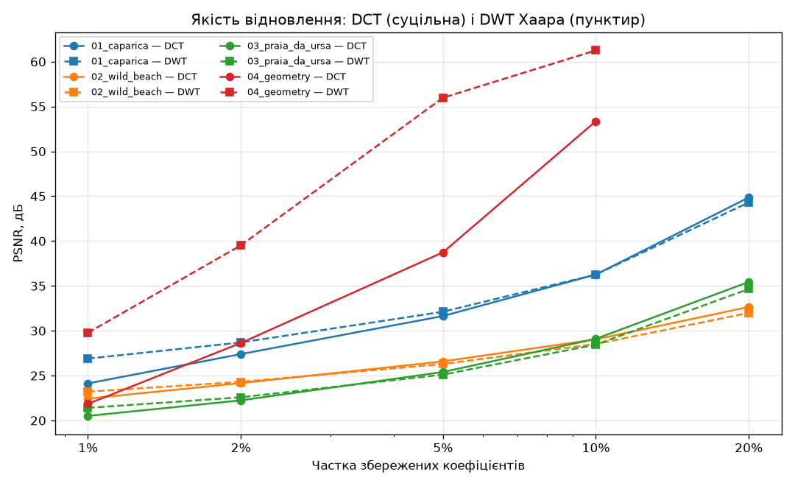

# Стиснення зображень з втратами: DCT і DWT

Лабораторна робота №3. Програма стискає зображення у відтінках сірого двома методами — **дискретним косинусним перетворенням (DCT)** блоками 8×8 і **дискретним вейвлет-перетворенням Хаара (DWT)** — і показує результати поруч: **Оригінал | DCT | DWT** зі значеннями PSNR. Частку збережених коефіцієнтів можна змінювати повзунком.

## Запуск

```
pip install -r requirements.txt
python main.py                  # тестові зображення з папки images
python main.py фото.jpg …       # будь-які свої зображення
python experiments.py           # таблиця і графіки → папка results
python -m unittest discover -s tests -t .
```

Будь-яке зображення переводиться у відтінки сірого й приводиться до 512×512 (центральний квадрат); 16-бітні зображення масштабуються до 8 біт, прозорі ділянки кладуться на біле тло. Файли, які не вдалося відкрити, пропускаються з повідомленням.

У вікні: верхній ряд — оригінал і відновлені зображення з PSNR; нижній — збережені коефіцієнти обох методів; повзунок — частка збережених коефіцієнтів (0,5–50 %); перемикач — зображення.

## Власна реалізація

Готові функції `dct()`, `idct()`, `dwt()`, `idwt()` не використовуються. NumPy — лише для масивів і множення матриць, Pillow — для читання зображень, matplotlib — для вікна й графіків.

### DCT — `compression/dct.py`

Матриця DCT розміром 8×8:

    C[k, n] = α(k) · cos(π · (2n + 1) · k / 16),   α(0) = √(1/8),  α(k) = √(2/8)

Рядок k — косинусна хвиля частоти k. Для кожного блоку 8×8:

    пряме:    Y = C · X · Cᵀ
    обернене: X = Cᵀ · Y · C

Матриця ортонормована (C · Cᵀ = I), тому обернена — транспонована. Зображення 512×512 ділиться на 64 × 64 = 4096 блоків, і всі вони перетворюються одним матричним множенням. `Y[0, 0]` — середня яскравість блоку (DC), далі — дедалі вищі частоти.

### DWT Хаара — `compression/haar.py`

Для пари сусідніх пікселів (a, b):

    s = (a + b) / √2    — низькі частоти (згладжене зображення)
    d = (a − b) / √2    — високі частоти (деталі)
    обернене: a = (s + d) / √2,  b = (s − d) / √2

Крок застосовується до рядків, потім до стовпців — виходять чотири підсмуги: LL (зменшена копія), LH, HL, HH (деталі). Наступний рівень розкладає лише LL. Використано **5 рівнів** (LL 16×16): експеримент показав, що далі PSNR майже не зростає.

### Зменшення кількості коефіцієнтів — `compression/codec.py`

Обраний механізм — **збереження заданої частки найбільших за модулем коефіцієнтів**:

1. яскравість центрується навколо нуля (x − 128, як у JPEG);
2. пряме перетворення;
3. із 262 144 коефіцієнтів залишаються не більше p % найбільших за модулем, решта обнуляються;
4. обернене перетворення, + 128, округлення й обрізання до 0…255.

Обидва методи отримують **однаковий ліміт** коефіцієнтів, тому порівняння чесне. Нульові коефіцієнти (однотонні області) не зберігаються: якщо значущих менше за ліміт, метод використовує менше — наприклад, Хаару для синтетичного зображення при ліміті 20 % вистачає 37 396 коефіцієнтів замість 52 429.

**Коефіцієнт стиснення** = кількість усіх коефіцієнтів / кількість збережених ненульових (наприклад, 5 % → 20 : 1). Це не розмір файлу: щоб отримати файл, треба ще записати значення й позиції ненульових коефіцієнтів (квантування, ентропійне кодування), тож реальний виграш буде меншим.

### PSNR

    MSE  = середнє (оригінал − відновлене)²   за всіма пікселями
    PSNR = 10 · log10(255² / MSE), дБ

Що вища PSNR, то ближче до оригіналу: понад 40 дБ — відмінності майже не помітні, 30–40 — добра якість, менше 25 — помітні артефакти. Якщо зображення однакові, MSE = 0 і PSNR = ∞.

## Тестові зображення

| Файл | Що на ньому |
|---|---|
| `01_caparica.png` | пляж Costa da Caparica: велике гладке небо, пісок, людина, каміння |
| `02_wild_beach.png` | дикий пляж з обриву: піна прибою, трава, скелі — багато дрібних деталей |
| `03_praia_da_ursa.png` | Praia da Ursa: скелі, вода, галька |
| `04_geometry.png` | синтетичне: градієнт, різкі краї, шахівниця, тонкі лінії, текст |

Перші три — кадри з власного відео (лабораторна №1).

## Результати

Повна таблиця — `results/results.md`, графік — `results/psnr.png`, візуальне порівняння на рівнях 1 %, 5 % і 20 % — `results/<зображення>.png`.

| Зображення | Ліміт | Збережено DCT (стиснення) | Збережено DWT (стиснення) | PSNR DCT, дБ | PSNR DWT, дБ | Краще |
|---|---|---|---|---|---|---|
| 01_caparica | 1 % | 2 621 (100 : 1) | 2 621 (100 : 1) | 24.13 | 26.89 | DWT |
| 01_caparica | 5 % | 13 107 (20 : 1) | 13 107 (20 : 1) | 31.64 | 32.12 | DWT |
| 01_caparica | 20 % | 52 429 (5 : 1) | 52 429 (5 : 1) | 44.86 | 44.30 | DCT |
| 02_wild_beach | 1 % | 2 621 (100 : 1) | 2 621 (100 : 1) | 22.43 | 23.21 | DWT |
| 02_wild_beach | 5 % | 13 107 (20 : 1) | 13 107 (20 : 1) | 26.58 | 26.29 | DCT |
| 02_wild_beach | 20 % | 52 429 (5 : 1) | 52 429 (5 : 1) | 32.65 | 31.99 | DCT |
| 03_praia_da_ursa | 1 % | 2 621 (100 : 1) | 2 621 (100 : 1) | 20.50 | 21.40 | DWT |
| 03_praia_da_ursa | 5 % | 13 107 (20 : 1) | 13 107 (20 : 1) | 25.40 | 25.10 | DCT |
| 03_praia_da_ursa | 20 % | 52 429 (5 : 1) | 52 429 (5 : 1) | 35.44 | 34.66 | DCT |
| 04_geometry | 1 % | 2 621 (100 : 1) | 2 621 (100 : 1) | 21.84 | 29.78 | DWT |
| 04_geometry | 5 % | 13 107 (20 : 1) | 13 107 (20 : 1) | 38.74 | 55.98 | DWT |
| 04_geometry | 20 % | 52 429 (5 : 1) | 37 396 (7 : 1) | ∞ | ∞ | ≈ |



### Візуальна якість

- **1 %** — обидва методи сильно спотворюють зображення. DCT: чіткі квадрати 8×8 (від блоку лишається майже лише середня яскравість), «сходинки» на небі. DWT: прямокутна «мозаїка» різного розміру, але контури скель чіткіші.
- **5 %** — DCT: блочність на гладкому небі, текстура гальки збережена. DWT: квадратні плями на небі, текстура трохи розмита. Загалом якість схожа.
- **20 %** — обидва результати майже не відрізняються від оригіналу.
- **Синтетичне зображення** — у DCT «дзвін» (ореоли) навколо тонких ліній і тексту та блоки на градієнті; Хаар майже ідеально відновлює прямі краї й однотонні області, але плавний градієнт перетворюється на сходинки.

## Висновки

1. Обидва перетворення зосереджують енергію зображення в невеликій кількості коефіцієнтів: якщо зберегти лише 5 % (стиснення 20 : 1), PSNR фотографій становить 25–32 дБ, а при 20 % — 32–45 дБ.
2. **При сильному стисненні (1–2 %) кращий DWT** на всіх зображеннях — для фотографій на 0,2–2,8 дБ. Багаторівневий розклад Хаара охоплює все зображення, а DCT обмежений блоками 8×8: коли коефіцієнтів дуже мало, від блоку лишається тільки середнє, і з'являється блочність.
3. **При помірному стисненні (5–20 %) на фото з текстурою кращий DCT** — для дикого пляжу й Praia da Ursa на 0,3–0,8 дБ: косинуси краще описують плавні зміни яскравості й текстури, ніж кусково-сталі функції Хаара. На знімку Caparica з великим гладким небом DWT кращий до 5 %, а при 20 % — DCT.
4. **На зображенні з різкими краями й однотонними областями Хаар переважає з великим відривом** — на 8–17 дБ, бо його базисні функції кусково-сталі, тобто якраз такі, як це зображення. Тому ж при ліміті 20 % Хаару для точного відновлення вистачає 37 396 коефіцієнтів (7 : 1), а DCT використовує весь ліміт — 52 429 (5 : 1).
5. PSNR правильно впорядковує результати за якістю, але не описує тип артефактів: блочність DCT і «мозаїка» Хаара за однакового PSNR виглядають по-різному, тому числову оцінку варто доповнювати переглядом.

## Структура

| Файл | Що робить |
|---|---|
| `main.py` | вікно порівняння з повзунком і перемикачем зображень |
| `experiments.py` | експерименти на 5 рівнях стиснення: таблиця, графік, сітки зображень |
| `compression/dct.py` | матриця DCT, пряме й обернене DCT блоками 8×8 |
| `compression/haar.py` | пряме й обернене багаторівневе перетворення Хаара |
| `compression/codec.py` | читання зображення, збереження найбільших коефіцієнтів, PSNR |
| `tests/test_compression.py` | 22 тести: збіг DCT з формулою, ортонормованість, ручний приклад Хаара, точне відновлення, перевірка розмірів, механізм стиснення (нулі не рахуються), PSNR, читання зображень (кольорові, 16-бітні, прозорі, некоректні) |
